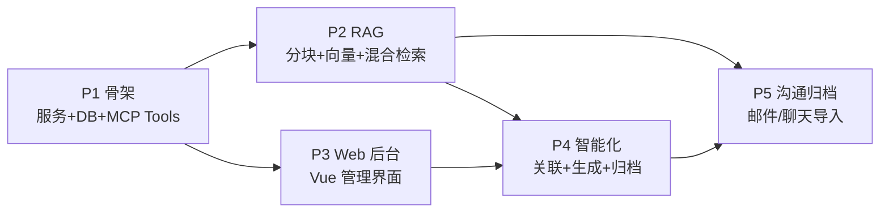

# 项目文档管理 MCP 服务 — 方案设计

> 目标：构建一个自托管的 Node.js MCP 服务，作为"项目知识库 + 文档维护员"。
> AI 客户端（Trae / Claude / Cursor 等）通过 MCP 自动检索、更新、归档项目文档；
> 用户也可通过 Web 后台管理文档。解决文档散落、版本混乱、AI 缺乏项目上下文的问题。

## 定位与价值

- 文档散落在项目文件夹里，AI 只能靠猜路径或全文搜索找上下文
- 需求变更后文档容易过时，无人维护
- 本方案：给 AI 一个统一入口 —— **检索 → 修改 → 重建索引 → 归档** 全链路自动化
- 差异化：Notion/Confluence MCP 是"挂载外部服务"，本方案是**自托管、面向代码项目的轻量知识库**

## 技术选型

| 层 | 选型 | 说明 |
|---|---|---|
| 运行时 | Node.js 20+ / TypeScript | |
| MCP | `@modelcontextprotocol/sdk` | Streamable HTTP transport（常驻服务，Web 后台共用同一端口） |
| REST | Fastify | 轻量、性能好，与 MCP 同端口挂载 |
| 存储 | SQLite（`better-sqlite3`）+ `sqlite-vec`（向量）+ `FTS5`（关键词） | 零外部依赖，单文件备份 |
| 文档解析 | markdown 原生 / `mammoth`(docx) / `pdf-parse` | Phase 2 |
| 上传 | `@fastify/multipart` | |
| 前端 | Vue 3 + Vite + Element Plus + Pinia | Web 管理后台 |

### Provider 设计（关键决策）

> 注意：**Claude（Anthropic）和 DeepSeek 没有 Embedding API**，
> 因此 LLM 与 Embedding 拆分为两个独立的可配置 Provider：

- **LLM Provider**（摘要、文档自动关联、归档生成）：
  OpenAI / Claude / DeepSeek / 智谱 四选一，可配置
- **Embedding Provider**：双实现，**local 默认（零 key 开箱即用）**：
  - `local`（默认）：fastembed + bge-small-zh-v1.5（~100MB，512 维，CPU 推理，
    增量场景 20~60ms/块，比 API 免网络往返更快；首次运行自动下载模型）
  - `openai-compatible`（可选）：OpenAI 兼容协议
    （OpenAI `text-embedding-3`、智谱 `embedding-3` 等），
    可配置 baseUrl + model + key，质量更优按需切换
  - 两条路共用同一套增量向量化（content_hash）与失败降级逻辑

换厂商只改配置，不动代码：LLM 走统一 `chat(messages)` 抽象，Embedding 走统一 `embed(texts[])` 抽象。

## 目录结构

```
rag/
├─ package.json
├─ .env.example                  # API key 等敏感配置
├─ src/
│  ├─ server.ts                  # 入口：同端口挂 MCP + REST
│  ├─ config/index.ts            # 配置加载（config.json + env 覆盖）
│  ├─ mcp/
│  │  ├─ server.ts               # MCP 实例与 transport
│  │  └─ tools/                  # 每个文件注册一组 tools
│  │     ├─ projects.ts  documents.ts  search.ts  index.ts
│  ├─ services/                  # 业务逻辑（MCP 和 REST 共用）
│  │  ├─ project.ts  document.ts  chunk.ts
│  │  ├─ search.ts               # 混合检索 + RRF 融合
│  │  ├─ indexing.ts  archive.ts  linking.ts(P4)
│  ├─ llm/
│  │  ├─ registry.ts             # Provider 注册与工厂
│  │  ├─ llm/                    # openai / anthropic / deepseek / zhipu
│  │  ├─ embedding/              # openai-compatible 通用适配器
│  │  └─ prompts.ts
│  ├─ db/
│  │  ├─ index.ts                # 初始化 + migration
│  │  └─ schema.sql
│  └─ api/routes/                # REST 路由（给 Web 用）
├─ web/                          # Vue 3 + Vite 前端（独立 build，由服务托管静态文件）
└─ data/                         # 运行时数据（gitignore）
   ├─ app.db  ├─ files/  └─ config.json
```

## 数据表设计

```
projects            id, name, description, created_at, updated_at
documents           id, project_id, title, source_type(web|mcp|file|email|chat|meeting),
                    metadata(json), latest_version_id, created_at, updated_at
                    -- metadata: 发件人/收件人/日期/thread_id 等沟通元数据(P5)
document_versions   id, document_id, version_no, content, change_note,
                    created_by, created_at          -- 每次更新都留版本
chunks              id, document_id, version_id, seq, heading_path,
                    content, token_count, content_hash  -- hash 支撑增量向量化
chunks_fts          FTS5 虚拟表(content)             -- BM25 关键词检索
chunks_vec          sqlite-vec 虚拟表(embedding)      -- 向量检索
doc_links           id, project_id, source_id, target_id,
                    type(auto|manual|llm), score, reason
snapshots           id, project_id, version_no, title,
                    type(functional|usage|requirements|snapshot), content,
                    source_doc_ids(json), created_at -- 生成类文档/归档
```

要点：**版本挂在 `document_versions`**，AI 通过 MCP 改文档 = 追加新版本而不是覆盖；
chunk 关联到产生它的 version，回滚历史版本时检索也不会错。

## MCP Tools 定义（Phase 1 实现 1-9）

| # | Tool | 参数 | 说明 |
|---|---|---|---|
| 1 | `list_projects` | — | |
| 2 | `create_project` | `name, description?` | |
| 3 | `list_documents` | `project_id` | 返回标题+更新时间+版本号 |
| 4 | `add_document` | `project_id, title, content? \| file_path?, change_note?` | content 为直接文本，file_path 读本地文件 |
| 5 | `get_document` | `document_id 或 (project_id+title), version?` | 不传 version 返回最新 |
| 6 | `update_document` | `document_id, content, change_note?` | 写入新版本 → 自动重新分块/embedding → 更新索引 |
| 7 | `delete_document` | `document_id` | 软删除 |
| 8 | `search_documents` | `project_id, query, top_k?=8` | 混合检索，返回片段+所属文档+标题路径+得分 |
| 9 | `rebuild_index` | `project_id` | 生成/更新《项目文档索引》特殊文档（目录+各文档摘要） |
| 10 | `generate_document` | `project_id, type: "functional"\|"usage"\|"requirements", doc_ids?, include_changelog?=true` | P4：LLM 聚合生成最新版功能文档/使用说明/需求文档，见「文档生成与变更记录机制」 |

`update_document` 是整条链路的枢纽 —— AI 改需求文档后，服务端自动完成分块、
向量化、索引刷新，AI 下次 `search_documents` 拿到的就是新内容。

> **名称模糊解析（P5 后补强）**：所有工具的 `project_id` / `document_id` 参数
> 同时接受 id 或名称。名称经 `normalizeName`（小写 + 去空格/下划线/横线/点）后
> 按「精确 id → 名称精确 → 归一化相等 → 双向包含」四级匹配；唯一命中直接使用，
> 多候选/零命中时返回带候选列表（含 id 前缀）的错误，由 AI 自动追问消歧。
> 目的：AI 对话中传来的名称与库中字符串不可能逐字一致（少空格、少字、分隔符差异），
> 解析层在服务端根治，各 tool 无需各自处理。

## REST API（Phase 3，Web 后台用）

```
GET/POST   /api/projects
GET/PUT/DELETE /api/documents/:id
POST       /api/projects/:id/documents        # multipart 上传
GET        /api/documents/:id/versions        # 版本历史/对比
POST       /api/search                        # {projectId, query}
GET        /api/settings  PUT /api/settings   # Provider 配置（key 脱敏返回）
```

## 配置设计

`data/config.json`（key 建议放 `.env`，config 里引用环境变量名）：

```json
{
  "llm": {
    "provider": "zhipu",
    "options": { "openai": {}, "anthropic": {}, "deepseek": {}, "zhipu": {} }
  },
  "embedding": {
    "provider": "local",
    "local": { "model": "BAAI/bge-small-zh-v1.5" },
    "baseUrl": "https://open.bigmodel.cn/api/paas/v4",
    "model": "embedding-3",
    "apiKeyEnv": "ZHIPU_API_KEY"
  },
  "chunking": { "maxTokens": 800, "overlap": 100 },
  "server": { "port": 3210 }
}
```

## 检索策略（Phase 2）

1. 查询同时走 FTS5（BM25）和 sqlite-vec（余弦相似度）
2. RRF（Reciprocal Rank Fusion）融合排序，无需调权重
3. 返回片段带 `heading_path`（如 `需求说明 > 支付模块 > 退款流程`），
   AI 拿到即可定位上下文

## 向量化成本与增量更新策略

### 原理

```
文档 → 分块(按标题切,每块~800 token) → 每块调 embedding API → 定长向量(如1024维)
     → 存入 sqlite-vec
检索时: 查询文本 → embed 一次(仅查询本身) → 与库中向量算余弦相似度 → 排序返回
```

向量是**一次生成、反复使用**的：检索时不碰原文档，只算向量距离，
检索本身毫秒级、零 API 消耗。

### 成本量级（API 方案，以智谱 embedding-3 约 0.5元/百万token 为例）

| 操作 | Token 消耗 | 时间 | 费用 |
|---|---|---|---|
| 初次导入 100 篇文档（每篇 5KB，共约 25万 token） | 25万 | 批量并行 5~20 秒 | 约 0.1 元 |
| 单篇文档首次入库（约 5000 token） | 5000 | 0.3~1 秒 | 约 0.0025 元 |
| AI 改一篇文档后重新向量化（增量） | 仅变更块 | 0.5~2 秒 | 可忽略 |
| 每次搜索时的 query 向量化 | 几十 token | 约 100ms | 可忽略 |

embedding 单价比 chat 模型低 1~2 个数量级，日常链路上的增量开销为
**亚秒级 + 不到一分钱**，不构成瓶颈。

### 实测性能（2026-10-19，P2 深度测试）

**local 模型（BAAI/bge-small-zh-v1.5，512 维，CPU 推理）真实链路**
（scripts/smoke-vector-e2e.mjs，9/9 通过）：

| 操作 | 实测耗时 | 说明 |
|---|---|---|
| 4 块文档向量化（含模型加载） | 261ms | 模型常驻进程后单次批量更快 |
| 语义检索全链路（query 向量化 + KNN + RRF） | 20ms | 远优于 API 方案预估的 ~100ms |
| 更新文档时未变章节向量搬运（hash 复用 3 块） | 2ms | 纯 SQLite 操作，零推理成本 |
| 变化块补算 | 仅 1 块 | 增量策略按预期工作 |
| 更新后混合检索（复用 + 新向量） | 正常命中 | 「发票能不能归档」语义命中 |

**DB 管线规模测试**（tests/vector-advanced.test.ts，fake embedder 隔离 DB 开销）：

| 操作 | 实测耗时 |
|---|---|
| 250 篇文档入库（750 chunk，含分块 + FTS 触发器） | 38ms |
| 750 块批量向量化入库（sqlite-vec 事务插入） | 8ms |
| 单次混合检索（KNN + FTS + LIKE + RRF） | 1ms |

结论：**性能瓶颈不在 DB/向量管线，而在 embedding 推理本身**。
local 模型常驻后批量推理约 30~60ms/块，千块级文档库的增量更新与检索
均在亚秒级完成，与 API 方案的成本预估结论一致——不构成瓶颈。
模型加载（~200ms）仅发生在进程启动后首次调用，由 retry loop 与
工具内联补算自然摊薄。

### 实测性能（2026-10-19，P4 智能化）

真实模型（bge-small-zh，服务端常驻）+ localhost 网络往返
（scripts/smoke-p4.mjs，12/12 通过，性能数据随验收产出）：

| 操作 | 实测耗时 | 说明 |
|---|---|---|
| add_document（含向量化 + 自动关联，每篇） | 28ms | 关联建立在向量化完成后，串行无感 |
| update_document（增量向量化 + 关联重建） | 28ms | hash 复用使变更块极少，整链路亚 30ms |
| generate_document（机械聚合 4 篇 + 向量化 10 块） | 174ms | LLM 模式另加 LLM 推理耗时（数秒级，仅按需触发） |
| trace 段落级溯源（REST，任意两版本块级对比） | 1ms | 纯 hash 集合比对 |
| search_documents（混合检索） | ~20ms | 见 P2 实测 |

结论：P4 的关联/溯源/聚合本身均为纯 SQLite 操作（毫秒级），
LLM 生成是唯一显著成本项，且遵循「按需触发、不随变更自动重生成」
的使用节奏约定，日常链路开销可忽略。

### 增量更新（核心约定，Phase 2 实现时遵循）

`update_document` 后**不做全文重算**，流程为：

1. 新版本内容重新分块
2. 每块计算内容哈希（`content_hash`），与旧版本 chunk 对比
3. 哈希相同的块 → 直接复用旧向量，不调 API
4. 只有新增/变更的块才调 embedding

实际场景中 AI 改需求通常只动一个章节，一篇 10 块的文档往往只有 1~2 块变化，
API 调用仅 1 次。chunks 表需增加 `content_hash` 字段支撑此策略。

### 其他约定

- chunk 挂在 `document_versions` 上，旧版本 chunk 在新版本索引完成后清理，
  向量库不会无限膨胀
- 初次批量导入大量文档时采用**后台异步分批**处理（Web 上传返回"处理中"，
  跑完即生效），不阻塞 AI 使用
- 备选路径：本地 embedding（fastembed），首次需下载模型，之后无 token 费用

## 文档生成与变更记录机制（Phase 4）

随着文档逐步积累，`generate_document` 支持直接从 MCP 数据生成
最新版功能文档 / 使用说明 / 需求文档，并附变更记录。

### generate_document 流程

1. 圈定范围：使用传入的 `doc_ids`；未传则由 AI 先通过
   `search_documents` 检索圈定相关文档
2. 服务端 LLM 读取各文档最新版本内容，按 `type` 对应模板聚合改写
3. 生成结果写入 `snapshots`（`source_type: generated`），记录
   数据来源文档与生成时间；每次生成都是新版本，旧版本留在历史中
4. `include_changelog=true` 时在文末自动附「变更记录」章节

### 变更记录机制

数据基础：每次 AI/人工改文档都写入 `document_versions`
（version_no、content、change_note、created_at、created_by），
变更时间线从第一天起自然积累，无需额外记录。

生成「变更记录」章节的粒度分两级：

| 粒度 | 可行性 | 做法 |
|---|---|---|
| **文档级** | ✅ 起步实现 | 从 `document_versions` 汇总：哪些文档、何时、被谁、改了什么（change_note） |
| **段落级** | ⚠️ P4 增强 | 对相邻版本做行级/块级 diff，标注段落来源于哪个版本 |

起步先做文档级变更记录（约 80% 价值），段落级溯源作为后续增强项。

### 使用节奏约定

- **不要每次变更都自动重新生成全文**：浪费 LLM token 且频繁变动。
  AI 改完文档后只刷新索引，完整文档按需触发（或攒批变更后触发）
- 生成质量取决于文档覆盖度：AI 只能聚合库中已有的内容，
  文档越全，生成的功能文档/使用说明越可信

## 客户沟通记录归档（Phase 5 扩展）

将「文档源」从项目文档扩展到客户沟通记录（邮件/聊天/会议/OCR 等），
底层分块、向量化、版本、检索、生成能力全部复用。
核心价值：**需求变更可追溯**——客户临时需求变更时有据可查。

> **2026-10-19 修正**：不做 `.eml`/`.msg` 文件解析与 IMAP 邮箱集成——
> 沟通记录的实际形态是「一段文字」（手打、聊天粘贴、OCR 提取的图像文字），
> 直接文本录入即可。邮箱/文件集成留作远期扩展。

### 架构扩展点

| 扩展点 | 做法 |
|---|---|
| 来源类型 | 统一 `source_type: 'communication'`，渠道差异放 `metadata.channel`（email/wechat/phone/ocr/meeting…），新增渠道零成本 |
| 沟通元数据 | `documents.metadata` JSON 字段：channel（渠道）、parties（参与方）、occurred_at（沟通时间）、source_note |
| 录入渠道 | MCP tool `add_communication`：AI 对话中直接归档一段沟通记录（含可选手动关联需求文档）；复用分块/向量化/自动关联全管线 |
| 生成类型 | `generate_document` 的 type 扩展 `communication_summary`（客户沟通纪要：时间线 + 依据链） |
| 关联 | P4 自动关联已建立沟通记录 ↔ 需求文档双向链；`add_communication` 支持 `related_document_ids` 手动补 manual 关联 |

### 需求变更追溯链路

```
客户在微信/邮件/会议里提出"功能改一下"
  → 归档进 MCP（AI 对话中调 add_communication，一段话 + 渠道 + 参与方 + 时间）
  → 自动分块/向量化/关联需求文档
  → AI 检索：search_documents 命中原始记录原文 + 时间戳
  → AI 提示：属需求变更，原方案 X 月 X 日沟通已确认/变更
  → AI 更新需求文档（新版本），change_note 写明变更来源
  → generate_document(type=communication_summary) 生成沟通纪要，引用需求文档依据
```

效果：事后争议（"当初不是这么说的"）可通过 `search_documents`
检索原始沟通记录原文与时间戳，**争议有据可查**。

### 实施注意事项

- **沟通记录质量取决于录入习惯**：录入时尽量带渠道、参与方、时间三要素，
  纪要与追溯才有据可查
- **合规优势**：沟通记录涉及客户隐私，自托管 + 本地 SQLite
  恰好是合规友好型架构，数据不出本机

## 分期与验收

| 阶段 | 内容 | 验收标准 |
|---|---|---|
| P1 骨架 | 服务 + DB + tools 1-9（search 先用 FTS5 全文检索） | 在 Trae/Claude 里配置后：建项目→加文档→搜索→改文档→查版本，全链路可用 |
| P2 RAG | 分块 + embedding + 混合检索 | 中文语义查询（"支付相关的需求"）能命中关键词搜不到的文档 |
| P3 Web 后台 | Vue 管理界面 + 上传 + 版本对比 | 后台上传的文档 AI 能搜到，AI 改的文档后台能看到 |
| P4 智能化 | 文档自动关联、`generate_document` 生成功能/使用/需求文档（含文档级变更记录）、需求变更联动更新 | 改一处需求，关联文档提示同步；可随时生成附变更记录的最新版文档 |
| P5 沟通归档 | 客户沟通记录归档：邮件/聊天导入（.eml、IMAP）、沟通↔需求关联、沟通纪要生成 | 客户需求变更可追溯到原始邮件/聊天记录，争议有据可查 |

## 实施路线图

### 阶段依赖关系



> P2 与 P3 相互独立，可并行推进；P4 依赖 P2+P3；P5 依赖 P2（检索）与 P4（生成/关联）。

### 关键依赖注记（开始 P1 前必须明确）

1. **P1 内置"最小分块"**：`search_documents` / `rebuild_index` 依赖
   `chunks`/`chunks_fts` 有数据，而分块任务列在 P2。P1 的 Tools 1-7 在
   add/update 时即按标题层级朴素分块并写入 chunks + chunks_fts；
   P2 只做分块增强（token 上限、overlap、docx/pdf 解析），不是从零开始
2. **P1 `rebuild_index` 不依赖 LLM**：LLM Provider 抽象在 P2，
   P1 版"摘要"用首段截断（取每篇文档前 N 字），LLM 摘要 P2 后升级；
   P1 验收只看目录+基本摘要可用
3. **P1 search service 按"检索入口 → 多路召回 → 融合排序"分层**：
   P1 只有一路 FTS5 召回也要保持此分层，P2 的向量召回路和
   embedding 失败降级都挂在这层分支上，避免 P2 重写
4. **外部依赖：MCP 客户端自定义 headers**：P1 加 Bearer token 后，
   AI 客户端配置 Streamable HTTP 需携带 `Authorization` header。
   P1 初期先用最小 demo 验证 Trae/Claude/Cursor 是否支持自定义 headers；
   若不支持，该客户端走 stdio 双 transport 备用方案

### P1 内部执行顺序

```
1 初始化 → 2 schema ∥ 3 配置 → 4 MCP挂载 ∥ 5 鉴权 → 6 Tools1-7(含最小分块)
→ 7 Tool8 → 8 Tool9 → 9 测试(随6-8同步写) → 10 验收(依赖4的客户端headers验证)
```

### 任务清单（勾选跟踪进度）

**P1 骨架** — 状态：✅ 完成（2026-10-19）
- [x] 项目初始化（TypeScript + Fastify + better-sqlite3）
- [x] DB schema 建表 + migration 机制
      （`npm run build && node scripts/smoke-db.mjs` 可重复验证）
- [x] 配置加载（config.json + env 覆盖）
- [x] MCP Server（Streamable HTTP）挂载
      （`node scripts/smoke-mcp.mjs` 验证，5/5 通过）
- [x] MCP/REST 端点鉴权（静态 Bearer token，`.env` 配置）
- [x] Tools 1-7：项目/文档 CRUD（含版本机制 + 最小分块：
      按标题切并写入 chunks/chunks_fts，见依赖注记 1；
      `node scripts/seed-mock.mjs` 造数，`node scripts/smoke-tools.mjs` 验证 13/13）
- [x] Tool 8：`search_documents`（FTS5 全文检索，trigram 中文分词；
      service 按"入口→多路召回→融合"分层，见依赖注记 3；
      短词 LIKE 降级；`node scripts/smoke-search.mjs` 验证 11/11）
- [x] Tool 9：`rebuild_index`（朴素版：目录+首段截断摘要，不依赖 LLM，
      见依赖注记 2；索引文档每次重建追加版本）
- [x] 前置验证：MCP 客户端 HTTP 配置支持自定义 headers
      （已在 Trae 实测通过，无需 stdio 备用方案；
      **后续 Codex 接入时已实现 `--stdio` 双 transport 备用方案**，
      `node scripts/smoke-stdio.mjs` 验证 5/5）
- [x] 核心 service 集成测试（内存 SQLite）+ 可重复执行的验收脚本
      （`npm test` = vitest 28/28；验收脚本：smoke-db / smoke-mcp /
      smoke-tools / smoke-search，共 57 项断言）
- [x] 验收：AI 客户端配置后跑通 建项目→加文档→搜索→改文档→查版本
      （`node scripts/final-acceptance.mjs` 终验 6/6，可重复执行；
      并已在 Trae（HTTP）与 Codex（stdio）双客户端实测通过）

**P2 RAG** — 状态：✅ 已完成（2026-10-19，smoke-rag 语义验收 4/4 通过 + vitest 33/33）
- [x] LLM Provider 抽象（openai-compatible 三合一 + Anthropic，PRESETS 预置，无 key 优雅降级）
- [x] Embedding Provider 双实现（**local 默认零 key** + openai-compatible 可选）
      + sqlite-vec 接入 + 模型指纹/维度管理
- [x] 向量维度管理：记录 embedding 模型指纹，
      切换 provider/model 后重建向量索引（不同模型维度不同）
- [x] embedding 失败降级：文档/版本照常入库，跳过向量索引
      （检索降级为纯 FTS5），记录待补算队列（启动 10s 后首轮 + 每 5min 重试循环）
- [x] 文档解析与分块（md 原生 / mammoth / pdf-parse，按标题层级）
- [x] 增量向量化（content_hash 对比，只算变更块；update_document 向量搬运复用）
- [x] 混合检索：FTS5 + 向量 + RRF 融合（K=60）
- [x] 批量导入后台异步分批处理（retry loop + 工具内联 embedAfterWrite，批量 32 块）
- [x] 验收：中文语义查询能命中关键词搜不到的文档
      （「钱怎么退回来」命中 FTS/LIKE 均无法匹配的「退款流程」段落，source=vector）
      * 执行注记：曾出现 search 返回 "{}" 的 bug——tools 层把 async service 的
      Promise 直接传给 ok() 导致 JSON.stringify(Promise) === "{}"，
      已修复（await 后再序列化）；local 模型 BAAI/bge-small-zh-v1.5（512 维）
      经 HF 镜像（hf-mirror.com）预下载至 data/models，scripts/download-model.mjs
- [x] 深度测试（2026-10-19）：vitest 38/38（新增 vector-advanced 5 用例：
      RRF 双路融合排序、版本过滤防旧向量泄漏、软删除过滤、500+ chunk 规模性能、
      topK 边界）+ scripts/smoke-vector-e2e.mjs 真实模型端到端 9/9
      （真实推理 4 块 261ms / 检索 20ms / hash 复用 3 块 2ms）

**P3 Web 后台** — 状态：✅ 已完成（2026-10-19，smoke-web 验收 7/7 + 浏览器 UI 实测正常）
- [x] Vue 3 + Vite + Element Plus 脚手架（web/，Vite 5 兼容 Node 20，Pinia + vue-router + diff）
- [x] REST API 路由（projects/documents/search/settings；同端口 /api，
      与 MCP 共用 services 层；附 DELETE /api/projects/:id 级联删除）
- [x] 服务托管 web 静态文件（@fastify/static v8 + SPA fallback，
      web/dist 存在即自动启用，无需额外 Nginx）
- [x] 项目/文档管理页 + multipart 上传（md/txt/docx/pdf，@fastify/multipart，
      上传后内联向量化；新增 parseDocumentBuffer 内存解析）
- [x] 版本历史与对比页（版本时间线 + jsdiff 行级 diff，任意两版对比）
- [x] Provider 设置页（key 脱敏：只回传 hasKey + 末 4 位 hint，不回明文；
      保存后热切换 provider——resetLlm/resetEmbedder，embedding 模型变化
      自动触发指纹重建向量表）
- [x] 验收：后台上传的文档 AI 能搜到，AI 改的文档后台能看到
      （scripts/smoke-web.mjs 7/7：REST↔MCP 双向打通；浏览器实测
      项目/检索/设置/详情四页渲染正常，语义检索「钱怎么退回来」命中 8 条）
      * 鉴权约定更新：/health 与静态页免鉴权；/api 本机（127.0.0.1）免 Bearer
      开箱即用，远程访问仍需 Bearer；/mcp 始终需要 Bearer
      * 冒烟：scripts/smoke-rest.mjs 11/11（含项目级联删除）；
      全量 vitest 38/38 无回归

**P4 智能化** — 状态：✅ 已完成（2026-10-19，smoke-p4 验收 12/12 + vitest 45/45）
- [x] 文档自动关联（向量质心相似度 → doc_links(type=auto)，embedAfterWrite
      内自动建立；阈值 0.6 / top3；listLinks 双向去重）
- [x] `generate_document` tool（functional/usage/requirements 模板 prompt；
      LLM 未配置 key / 调用失败时降级「机械聚合」——快照与变更记录不依赖 LLM；
      生成结果作为 generated 文档入库（同名追加版本），天然获得检索与 Web 可见；
      同时写 snapshots 留档记录 source_doc_ids）
- [x] 变更记录章节生成（文档级：document_versions 汇总为 markdown 表格，
      include_changelog=true 时文末附加）
- [x] 需求变更联动更新提示（add_document/update_document 返回体附带
      related.docs + 同步更新提示；MCP list_related_documents tool；
      Web 详情页展示关联文档警告条）
- [x] （增强）段落级溯源：相邻/任意版本块级 diff（content_hash 判沿用 +
      heading/位置判改写），REST GET /api/documents/:id/trace?from=&to=
      * 执行注记：为支撑溯源，updateDocument 改为保留历史版本 chunks
      （原实现物理删除全部旧 chunk；检索层 JOIN latest_version_id 保证
      无数据泄漏，已有测试覆盖）；doc_links embedding 读取兼容 float32 BLOB
- [x] 验收：改一处需求，关联文档提示同步（update 返回「接口设计(0.90)」
      关联提示且排名高于无关文档）；可生成附变更记录的最新版文档
      （变更记录含「退款期限 7 天改 15 天」条目；重复生成追加 v2）
      * 冒烟：scripts/smoke-p4.mjs 12/12；deleteProject 级联补全
      doc_links/snapshots 清理（FK 顺序：doc_links → documents）

**P5 沟通归档** — 状态：✅ 已完成（2026-10-19，smoke-p5 验收 10/10 + vitest 45/45）
      * 2026-10-19 修正：不做 .eml/.msg 解析与 IMAP——沟通记录以一段文字
      直接录入（手打/粘贴/OCR 提取文本），统一 source_type='communication'
      + metadata.channel 标注渠道
- [x] `documents.metadata` 字段读写链路落地（addDocument 暴露 metadata 参数，
      getDocument 返回解析后的 metadata）
- [x] MCP tool `add_communication`（一段话 + channel/parties/occurred_at
      + 可选 related_document_ids 建 manual 关联；复用分块/向量化/自动关联；
      标题默认「沟通记录 <时间> <渠道>」）
- [x] 沟通记录 ↔ 需求文档关联（复用 P4 自动关联 + linkDocuments manual 补链，
      双向可查）
- [x] `generate_document` 扩展 `communication_summary`（LLM 模板 + 机械聚合
      时间线模式：按 occurred_at 排序，每条标注 日期 · 渠道 · 参与方）
- [x] 验收：归档客户变更诉求（微信/2026-10-18/客户张三）→ 语义检索命中原文
      → 需求文档侧依据链可查 → 沟通纪要含时间线与原文依据 → 追溯闭环三要素
      （原文/依据链/纪要）齐备（scripts/smoke-p5.mjs 10/10）

## 实施边界与注意事项

- "自动将各个文档关联起来"用简单规则起步（相似度 + 引用链接），不追求全自动化，避免关联质量不可控
- API key 等敏感信息放 `.env`，config.json 只引用环境变量名
- `data/` 目录加入 `.gitignore`
