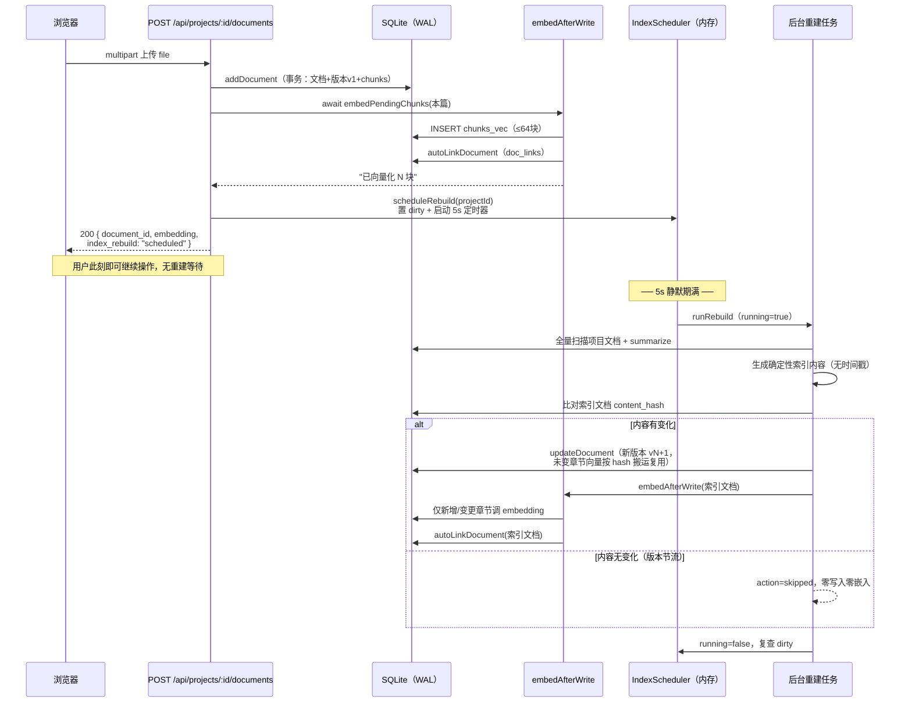
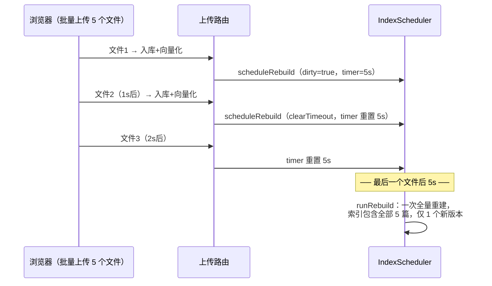
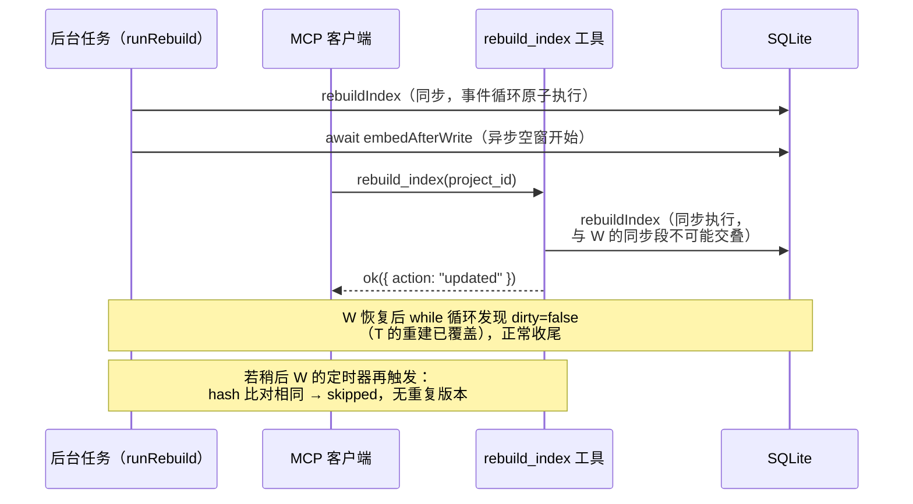
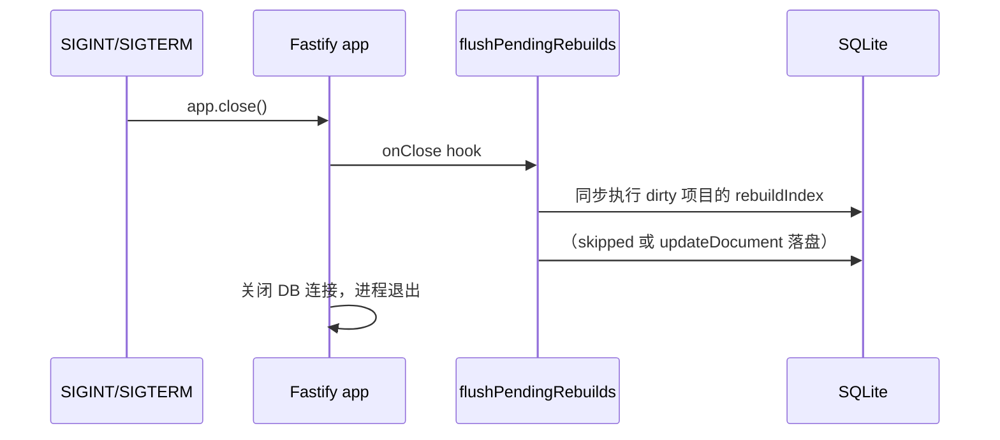

# Web 上传后自动重建索引 — 设计说明

> 状态：设计稿（未实施）
> 关联代码：`src/services/indexing.ts`、`src/api/routes/documents.ts`、`src/services/embedding.ts`、`src/services/document.ts`、`src/http/app.ts`、`src/config/index.ts`

---

## 1. 背景与现状

### 1.1 问题

《项目文档索引》（`source_type=index` 的特殊文档）目前只能通过 MCP 工具 `rebuild_index` 显式生成。Web 后台的三条写路径——上传、更新、删除——均不触发索引重建，纯 Web 使用场景下索引文档永远不会出现。

### 1.2 现状调用链

```
POST /api/projects/:id/documents        （documents.ts:28）
  ├─ parseDocumentBuffer                解析 md/txt/docx/pdf
  ├─ addDocument                        事务：documents + document_versions + chunks
  ├─ await embedAfterWrite              内联向量化（≤64 块）+ autoLinkDocument
  └─ 返回                               ← 到此结束，无 rebuildIndex

PUT  /api/documents/:id                 （documents.ts:117）
  ├─ updateDocument                     新版本 + hash 复用旧向量 + 重切 chunk
  ├─ await embedAfterWrite
  └─ 返回

DELETE /api/documents/:id               （documents.ts:137）
  └─ deleteDocument                     软删除（deleted_at）

MCP rebuild_index                       （mcp/tools/indexing.ts:10）
  └─ rebuildIndex                       唯一索引生成入口
```

### 1.3 直接内联重建的隐患（本设计要规避的）

| # | 隐患 | 根源 |
|---|------|------|
| P1 | 每次上传触发全量重建，O(项目总内容量) | `rebuildIndex` 全表扫描 + 全量 summarize，无合并机制 |
| P2 | 向量复用整体失效，每次重建全量重嵌 | 索引内容嵌入了 `自动生成于 ${ts}` 时间戳（indexing.ts:49）和每节的 `更新于` 时间，内容必变 → content_hash 全部失配 |
| P3 | 版本无限膨胀 | 每次 `updateDocument` 追加新版本并保留旧 chunks（溯源需要），上传 N 次 = N+1 个索引版本 |
| P4 | 请求延迟 + 事件循环阻塞 | better-sqlite3 同步驱动，重建在一个 JS tick 内完成，大项目卡住全部并发请求 |
| C1 | 向量化竞态 | `embedPendingChunks` 查询与 INSERT 之间有 await 空窗，与 5 分钟 retry loop 可选中同一 chunk，非 OR IGNORE 的 INSERT 撞 `chunks_vec` 主键 |
| C2 | 多实例写冲突 | SQLite 单写者，多进程同时重建产生重复索引版本 / SQLITE_BUSY |

---

## 2. 目标与非目标

### 目标

1. Web 路由与 MCP 工具的文档写入（上传/更新/删除）成功后，项目索引自动保持最新——**不依赖 AI 客户端主动调用 rebuild_index**（实践中 AI 不会主动调，见 4.2）。
2. 批量上传 N 个文件只产生 **1 次**重建（去抖合并）。
3. 重建不阻塞上传响应（后台异步执行）。
4. 未变化的文档章节**不重复向量化**（索引内容确定性化）。
5. 索引内容无实质变化时**不追加版本**（版本节流）。
6. 与 MCP 手动 `rebuild_index` 共存，不产生重复劳动。

### 非目标

- 不做增量索引（仍是"全量重算内容 + hash 节流"，朴素版够用，见第 8 节演进方向）。
- 不解决多实例部署下的索引互斥（单进程部署是既定约束，见第 7 节）。
- 不改动分块、检索、溯源等既有管线。

---

## 3. 方案总览

四个核心机制，全部落在 `indexing.ts` 一个模块内，路由层只加一行触发：

```
写操作(上传/更新/删除)成功
        │
        ▼
scheduleRebuild(projectId)     ① 只打脏标记 + 重置 5s 去抖定时器（毫秒级，不阻塞响应）
        │
        ▼  定时器触发（静默期满，且无同项目任务在跑）
runRebuild(projectId)          ② 单飞执行（running 标记）
        │
        ├─ 生成确定性索引内容（无时间戳）
        ├─ 与索引文档现有 content_hash 比对 → 相同则跳过   ③ 版本节流
        ├─ 不同 → updateDocument（hash 复用未变章节的向量）  ④ 增量向量化
        └─ embedAfterWrite(索引文档) 兜底补算新增块
```

---

## 4. 详细改动点

### 4.1 `src/services/indexing.ts` — 核心改造

#### 改动 A：索引内容确定性化（解决 P2）

`rebuildIndex` 中删除全局时间戳注入，改为纯确定性内容：

```ts
// 现状（indexing.ts:46-52）
const content = [
  `# 项目文档索引 — ${project.name}`,
  '',
  `> 自动生成于 ${ts}，共 ${docs.length} 篇文档。变更后可通过 rebuild_index 重新生成。`,
  ...
].join('\n');

// 改为：内容只由文档集合决定，时间戳移入 change_note
const content = [
  `# 项目文档索引 — ${project.name}`,
  '',
  `> 共 ${docs.length} 篇文档，随文档变更自动更新，也可通过 rebuild_index 手动重建。`,
  ...sections,
].join('\n');
```

- 每节的 `## ${d.title}（v${d.version_no}，更新于 ${d.updated_at}）` **保留**——`version_no` 与 `updated_at` 只在该文档本身变更时才变，天然满足"未变文档章节 hash 稳定"。
- 生成时间移入 change_note：`自动重建索引（N 篇文档，YYYY-MM-DD HH:mm:ss）`，版本历史里仍可追溯重建时间。

**效果**：单篇文档变更后重建，只有该文档的章节 chunk hash 变化，其余章节在 `updateDocument` 的向量搬运（document.ts:233-259）中按 hash 复用，零 embedding 调用。

#### 改动 B：版本节流（解决 P3）

`documents.content_hash` 已存最新版本全文档哈希（addDocument:189 / updateDocument:263 维护），直接比对：

```ts
if (existing) {
  const newHash = hashContent(content);          // 复用 services/hash.ts
  const row = db.prepare('SELECT content_hash FROM documents WHERE id = ?')
    .get(existing.id) as { content_hash: string };
  if (row.content_hash === newHash) {
    return { document_id: existing.id, version_no: 0, doc_count: docs.length, action: 'skipped' };
  }
  // ... 原有 updateDocument 分支，changeNote 带时间戳
}
```

返回类型 `action` 扩展为 `'created' | 'updated' | 'skipped'`。

#### 改动 C：去抖 + 单飞调度器（解决 P1 / P4 / 一半的 C1）

模块内新增（纯内存状态，无 DB 迁移）：

```ts
const DEBOUNCE_MS = 5_000;
const schedulers = new Map<string, {
  timer: NodeJS.Timeout | null;   // 去抖定时器（unref，不阻止进程退出）
  dirty: boolean;                 // 待重建标记
  running: boolean;               // 单飞标记
}>();

/** 写路径触发：仅打标记，O(1)，永不抛错、永不阻塞请求 */
export function scheduleRebuild(db: Db, projectId: string): void {
  let s = schedulers.get(projectId);
  if (!s) { s = { timer: null, dirty: false, running: false }; schedulers.set(projectId, s); }
  s.dirty = true;
  if (s.running) return;                       // 正在跑：跑完后会复查 dirty 再排一轮
  if (s.timer) clearTimeout(s.timer);          // 去抖：静默期内再写 → 重置计时
  s.timer = setTimeout(() => { s!.timer = null; void runRebuild(db, projectId); }, DEBOUNCE_MS);
  s.timer.unref();
}

async function runRebuild(db: Db, projectId: string): Promise<void> {
  const s = schedulers.get(projectId)!;
  s.running = true;
  try {
    while (s.dirty) {                          // 跑期间又脏了 → 就地再跑一轮，避免反复起任务
      s.dirty = false;
      try {
        const r = rebuildIndex(db, projectId);
        if (r.action !== 'skipped') {
          await embedAfterWrite(db, r.document_id);   // 索引文档新增块及时向量化
        }
      } catch (err) {
        console.error(`[indexing] 项目 ${projectId} 自动重建失败（下轮写操作重试）:`, err);
        s.dirty = false;                       // 失败不无限重试，等下次写操作再触发
      }
    }
  } finally {
    s.running = false;
    if (s.dirty && !s.timer) {                 // 兜底：执行期间又收到新标记
      s.timer = setTimeout(() => { s!.timer = null; void runRebuild(db, projectId); }, DEBOUNCE_MS);
      s.timer.unref();
    }
  }
}

/** 进程退出前调用：同步清空未完成的重建（rebuildIndex 本身是同步的） */
export function flushPendingRebuilds(db: Db): void {
  for (const [projectId, s] of schedulers) {
    if (s.timer) { clearTimeout(s.timer); s.timer = null; }
    if (s.dirty && !s.running) {
      s.dirty = false;
      try { rebuildIndex(db, projectId); } catch { /* 退出流程中静默 */ }
    }
  }
}
```

注意点：
- `rebuildIndex` 与 `addDocument`/`updateDocument` 全是同步函数，单进程事件循环保证它们不会互相交叠——**不需要显式互斥锁**。
- `await embedAfterWrite` 是唯一的异步空窗，此窗口内新的写操作只会置 `dirty`，由 `while` 循环或 `finally` 兜底消化。
- MCP 手动 `rebuild_index` 与后台任务并发是安全的：两者都是同步重建，不会交叠；手动重建后若后台定时器随后触发，改动 B 的 hash 节流会直接 `skipped`，不产生重复版本。

#### 改动 D：向量化竞态加固（解决 C1，一行）

`embedPendingChunks` 的 INSERT（embedding.ts:78）：

```ts
// 现状
const insert = db.prepare('INSERT INTO chunks_vec (chunk_id, embedding) VALUES (?, ?)');
// 改为
const insert = db.prepare('INSERT OR IGNORE INTO chunks_vec (chunk_id, embedding) VALUES (?, ?)');
```

两路并发（内联补算 vs retry loop）选中同一 chunk 时，后到者静默丢弃而非整批 32 块报错。向量由同一模型生成，先到先得语义无损。

#### 改动 E：索引新鲜度指纹（启动自愈的规模化前提，解决 4.3 的重建潮）

项目数很大时，启动自愈若对每个项目都做全量扫描（O(项目内容字节)）再靠 hash 节流跳过，T+5s 会形成一段同步阻塞潮。解法：重建时顺手把指纹写入索引文档的 `documents.metadata`（P5 已有 JSON 列，零迁移）：

```ts
// rebuildIndex 内：docs 数组已在内存，取指纹零成本；随 addDocument/updateDocument 的 metadata 落库
const fingerprint = {
  doc_count: docs.length,
  max_updated_at: docs.reduce((m, d) => (d.updated_at > m ? d.updated_at : m), ''),
};
```

`updateDocument` 需增加可选 `metadata` 参数（addDocument 已支持）。判定正确性——任何写路径必使指纹失配：

| 写路径 | 失配原因 |
|---|---|
| 新增文档 | `doc_count`、`max_updated_at` 同变 |
| 更新文档 | `updated_at = now()` 必大于旧 max |
| 删除文档 | `doc_count` 变化（软删被 COUNT 排除，恰好补上时间戳比对的删除盲区）|

指纹是**保守判断**：预检失配只代表"可能过期"，最终仍由 hash 节流兜底（假阳性 → `skipped`），安全性无损。存量索引文档无指纹 → 视为滞后 → 一次性全量重建补上，与 4.1-A 的一次性成本重合。

**两级闸门的降级路径**（预检误判时发生了什么）：

| | 闸门 1：指纹预检 | 闸门 2：hash 节流（4.1-B） |
|---|---|---|
| 决定什么 | 要不要调度一次重建 | 调度后要不要真的写库 |
| 成本 | O(元数据) | O(内容)：扫描 + 拼字符串 + hash 比对 |
| 判断性质 | 保守粗筛，允许误判 | 权威裁决，不会误判 |

预检假阳性（该跳过却重建）的净代价 = 一次 O(内容)**只读**扫描 + hash 比对，随后 `rebuildIndex` 因 `hashContent(新内容) === documents.content_hash` 返回 `skipped` → runRebuild 跳过 embedAfterWrite → **零版本行、零 chunk 重切、零向量操作、零 embedding**。可信度依赖两个不变量：`content_hash` 随每次写入事务内同步维护（document.ts:189/263）；索引内容确定性（4.1-A）使"同文档集合 ⇒ 逐字节同内容"。若无 4.1-A，hash 节流永不命中，本降级路径不存在——故实施顺序上 A/B 先于调度器。

**残留漏判风险**（反向，预检说新鲜实际滞后）：同项目两笔写入落在同一毫秒且含 update 时，指纹两项均不变而 `version_no` 已变。后果仅为索引落后一轮、下次写操作自愈，符合"最终一致"容忍度；如需封死，指纹加入 `SUM(version_no)` 即可。

### 4.2 写路径触发 — REST 路由与 MCP 工具（覆盖 Web / stdio 全部形态）

**REST 路由**（`src/api/routes/documents.ts`，三处各一行）：

```ts
// POST /api/projects/:id/documents（上传）embedAfterWrite 之后：
scheduleRebuild(getDb(), id);
return { ...r, embedding, duplicate_warning, index_rebuild: 'scheduled' };

// PUT /api/documents/:id（更新）：
scheduleRebuild(getDb(), id);

// DELETE /api/documents/:id（删除）：
scheduleRebuild(getDb(), id);   // 软删除后重建，索引中该节自动消失
```

**MCP 写工具**（`src/mcp/tools/documents.ts`，同样三处各一行）：

```ts
// add_document：ok() 之前
scheduleRebuild(getDb(), project.id);
// update_document / delete_document：resolveDocument 返回的 DocumentRow 含 project_id
scheduleRebuild(getDb(), doc.project_id);
```

MCP 触发点的意义：`rebuild_index` 依赖 AI 临场判断是否调用，实践中不可靠（实际使用已验证：stdio 模式下 AI 从不主动调用）。挂在写入路径本身后，**纯 stdio 模式也获得自动重建**——调度器在 `indexing.ts` 模块作用域，不依赖 HTTP app 存在；定时器 `unref`，客户端会话存活期间（stdin 保持读）正常触发。

**纯 stdio 的配套接线**（`src/server.ts` stdio 分支，三行）：

```ts
// 1) 启动自愈：stdio 会话启动时同样校准索引（指纹预检，毫秒级）
scheduleStartupRebuilds(getDb());
// 2) 待补算循环：纯 stdio 原本不启动 retry loop；自动重建后的 embedAfterWrite
//    已内联向量化索引文档，retry loop 仅兜底 flush 跳过 embed 的边缘场景
startPendingRetryLoop(getDb());
// 3) 会话结束：stdin 关闭 → 事件循环排空，去抖定时器已 unref 不会阻止退出，
//    在 beforeExit 同步补齐未触发的重建
process.on('beforeExit', () => flushPendingRebuilds(getDb()));
```

> 边缘场景说明：beforeExit 的 flush 是同步的（只做 rebuildIndex，不做 embed），若 flush 产生了新索引版本，其 chunk 向量化由 retry loop 兜底补算——这正是 stdio 分支也要启动 retry loop 的原因。

响应体新增 `index_rebuild: 'scheduled'` 字段（纯增量，旧前端不读也不报错）。前端如需展示，可在文档列表将 `source_type=index` 的标签逻辑复用（DocumentsView.vue:67 已有"自动索引"标签）。

### 4.3 `src/http/app.ts` — 退出清空 + 启动自愈

```ts
import { flushPendingRebuilds, scheduleStartupRebuilds } from '../services/indexing.js';

export async function startHttpApp(...) {
  ...
  startPendingRetryLoop(getDb());
  scheduleStartupRebuilds(getDb());          // 启动自愈：见下
  app.addHook('onClose', async () => { flushPendingRebuilds(getDb()); });
  return app;
}
```

**优雅关闭**（SIGINT/SIGTERM → app.close）：`onClose` 钩子同步补齐静默期内尚未落盘的重建，避免"最后一次上传的变更永远不进索引"。

**启动自愈**（`indexing.ts` 新增导出）：预检 + 错峰两级设计，避免项目多时的同步重建潮（改动 E）：

```ts
/** 启动时逐项目预检指纹，仅对疑似滞后的项目错峰排重建 */
export function scheduleStartupRebuilds(db: Db): void {
  const projects = db.prepare('SELECT id FROM projects').all() as { id: string }[];
  let stale = 0;
  for (const p of projects) {
    if (!isIndexPossiblyStale(db, p.id)) continue;   // 新鲜项目：O(元数据) 预检即跳过
    const delay = stale++ * 500;                     // 疑似项目：错峰，同步块之间留事件循环空隙
    setTimeout(() => scheduleRebuild(db, p.id), delay).unref();
  }
}

/** 指纹预检：两条轻查询，不读任何正文 */
function isIndexPossiblyStale(db: Db, projectId: string): boolean {
  const indexDoc = db.prepare(
    "SELECT metadata FROM documents WHERE project_id = ? AND title = ? AND deleted_at IS NULL",
  ).get(projectId, INDEX_TITLE) as { metadata: string } | undefined;
  if (!indexDoc) return true;                        // 无索引文档 → 必然重建
  let saved: { doc_count?: number; max_updated_at?: string };
  try { saved = JSON.parse(indexDoc.metadata); } catch { return true; }
  if (typeof saved.doc_count !== 'number' || typeof saved.max_updated_at !== 'string') return true;
  const cur = db.prepare(`
    SELECT COUNT(*) AS n, COALESCE(MAX(updated_at), '') AS m
    FROM documents WHERE project_id = ? AND deleted_at IS NULL AND title != ?
  `).get(projectId, INDEX_TITLE) as { n: number; m: string };
  return cur.n !== saved.doc_count || cur.m !== saved.max_updated_at;
}
```

覆盖崩溃 / kill -9 / 断电场景——脏标记随进程丢失后，服务重启时统一补齐，不依赖崩溃前的任何持久化状态。规模特征：

- **已最新项目**：每项目两条元数据级查询（索引文档 metadata + COUNT/MAX 聚合），千级项目总和毫秒级，不触碰正文。
- **疑似滞后项目**（正常启动时通常为零，崩溃瞬间在写的那几个）：错峰 500ms 执行全量重建，同步块之间 HTTP 请求可穿插。
- 指纹预检是保守判断，误判由 hash 节流兜底为 `skipped`；注意 COUNT 聚合覆盖了 `deleteDocument` 不更新 `updated_at` 的删除盲区（见改动 E 的失配表）。

### 4.4 `src/config/index.ts` — 开关（可选但建议）

`ServerConfig` 增加：

```ts
export interface ServerConfig {
  ...
  /** Web 写操作后自动重建项目索引；多实例部署时应关闭 */
  autoRebuildIndex: boolean;   // 默认 true
}
```

`scheduleRebuild` 开头检查开关，关闭时直接 return（MCP 手动路径不受影响）。环境变量覆盖沿用既有模式：`process.env.AUTO_REBUILD_INDEX === 'off'` 时置 false。

### 4.5 `src/mcp/tools/indexing.ts` — 不改动

`rebuild_index` 语义保持"立即同步重建"。改动 B 使其在内容无变化时返回 `skipped`（`ok()` 包装透传），工具描述补一句"内容无变化时跳过建版"。

### 4.6 不改动的文件

| 文件 | 理由 |
|---|---|
| `services/document.ts` | `updateDocument` 的向量搬运已满足增量向量化需求 |
| `services/embedding.ts` | 仅 4.1-D 的一行加固 |
| `db/migrations.ts` | 无 schema 变更 |
| `web/` 前端 | 响应字段纯增量；索引文档本身作为普通文档展示，列表已有标签 |

---

## 5. 时序图

### 5.1 单次上传（改造后主流程）



### 5.2 批量上传的去抖合并



对比现状假设（若内联重建）：5 次全量重建 + 5 个索引版本 + 5 轮全量重嵌 → 合并后 1 次重建、1 个版本、只嵌 1 篇新文档的摘要节。

### 5.3 与 MCP 手动重建并发



### 5.4 进程优雅关闭



---

## 6. 状态与数据结构

| 状态 | 位置 | 生命周期 | 崩溃后果 |
|---|---|---|---|
| `dirty` / `running` / `timer` | 进程内存 Map | 进程存活期 | 丢失 = 索引滞后；由启动自愈（4.3）或下次写操作补上（最终一致） |
| 索引文档及其版本 | `documents` / `document_versions` / `chunks` | 持久 | 无新增状态 |
| `content_hash` 节流依据 | `documents.content_hash`（已有列） | 持久 | 无 schema 变更 |
| 新鲜度指纹 `{doc_count, max_updated_at}` | `documents.metadata`（已有列，索引文档行） | 随每次重建更新 | 丢失/缺失 = 启动预检视为滞后，多一次全量重建后自动补上 |

无新表、无迁移、无持久化队列——崩溃丢失的只是一个"待重建"标记：优雅关闭由 `flushPendingRebuilds` 同步补齐，崩溃场景由启动自愈兜底，期间有写操作则自动提前恢复。

---

## 7. 边界情况与容错

| 场景 | 行为 |
|---|---|
| 项目只有 1 篇文档（被索引文档自身排除） | 首次重建 `created`，之后写操作 `skipped` |
| 索引文档被用户手动删除（软删） | `existing` 查询带 `deleted_at IS NULL`（indexing.ts:55 已处理）→ 重新 `created`；但软删的旧版本会残留向量，`updateDocument` 路径不存在此问题，无需处理 |
| 项目被物理删除 | `rebuildIndex` 抛"项目不存在" → 调度器 catch 记日志，dirty 清空，不再重试 |
| 重建/向量化失败 | 不阻塞任何写路径；失败后等下次写操作重触发，retry loop 兜底向量化 |
| `--stdio --web` 内嵌模式 | 与 HTTP 模式共用 `startHttpApp`，调度器同进程生效，行为一致；新代码日志走 stderr（`console.error`），不污染 stdout 的 MCP 协议通道 |
| 纯 stdio 模式（`--stdio` 无 `--web`） | 经 4.2 的配套接线后**同样获得自动重建**（MCP 写工具触发 + 启动自愈 + beforeExit flush）；stdout 纪律不受影响，唯一可见变化是 `rebuild_index` 可能返回 `skipped` |
| MCP 工具写入（add/update/delete_document） | 与 REST 路由同等触发 `scheduleRebuild`（4.2），Web 与 MCP 双写路径行为统一 |
| 大项目首次自动重建 | 全量扫描 + 全量嵌入只发生一次；此后靠 hash 复用增量 |
| 去抖期内优雅关闭 | `flushPendingRebuilds` 同步补齐 |
| 崩溃 / kill -9 丢失未触发标记 | 重启时 `scheduleStartupRebuilds` 全项目自愈；期间有写操作则提前恢复 |
| 上传内容与已有文档完全重复（duplicate_warning 场景） | 仍正常触发重建；若内容集合无变化则 `skipped` |

---

## 8. 部署形态适配性

### 8.1 官方形态：单进程集中部署、多人共享（主场景，完全适用）

[部署指南_HTTP多人使用.md](./部署指南_HTTP多人使用.md) 明确规定"所有请求由同一个服务进程处理""不要再起第二个进程指向同一 data 目录"——**单进程是官方强制部署形态**，进程内调度器在此形态下零折扣生效，且多人场景放大本方案价值：

| 多人集中部署的特有问题 | 本方案对应解法 |
|---|---|
| 索引无主：各同事自行上传，无人有调用 rebuild_index 的义务，索引永久缺失/滞后 | 上传即触发，5s 去抖后自动更新，协调成本归零 |
| 多人并发上传常见 | 去抖合并把 N 次并发写压成 1 次重建（单用户场景闲置的机制在此真正发挥作用） |
| 一次阻塞影响全部在线用户 | 坚持后台异步重建，绝不在请求内联执行 |
| 重启是常规运维（指南：改 token 需重启） | 启动自愈在每次重启后自动校准索引 |
| Web 上传是远程用户的唯一入库通道（无服务器文件系统，MCP file_path 不可用） | 补齐"上传后索引永不生成"的功能缺口——这正是本设计的出发点 |

**结论**：多人集中部署是本设计的第一目标场景，必要性评估从"取决于使用形态"升级为"明确必要"；改动 E（指纹预检）建议随步骤 3 一并实施，以应对团队使用带来的项目/文档量自然增长。

### 8.2 未来若引入多实例横向扩展（当前不存在）

调度器是**进程内存态**，多进程共用一个 `app.db` 时：

- 正确性仍可保：各进程的 `rebuildIndex` 都会读到全量最新数据，重复重建只是浪费；SQLite 单写者串行化实际写入，WAL 模式下不会读到半成品事务。
- 风险点：写锁竞争（`SQLITE_BUSY`，better-sqlite3 默认等 5s）。

届时设置 `AUTO_REBUILD_INDEX=off` 关闭自动重建，索引由指定实例或运维脚本定期触发——这也是 4.4 开关存在的原因。

### 8.3 多用户并发走查（结论：不影响正常运行）

并发模型与既有系统一致（单进程 + better-sqlite3 同步驱动 + 事务写入 + WAL），指南第六节已确认多人并发可用；本方案全部新逻辑遵循同一执行模型，调度器与 `rebuildIndex` 全同步、不可能被用户写操作打断。逐场景：

| 并发场景 | 行为与结果 |
|---|---|
| 两人同时上传同一项目 | addDocument 串行入库；两次 scheduleRebuild 被去抖合并为 1 次重建 |
| 上传撞上重建中 | 同步段无法交叠；异步空窗收到上传 → 置 dirty → while 循环消化，无丢失 |
| 两人编辑同一文档 | updateDocument 串行执行，各追加版本，last-writer-wins（既有行为不变） |
| 重建撞上 retry loop 向量化 | 改动 D `INSERT OR IGNORE` 静默去重 |
| 多人检索撞上重建扫描 | 请求排队等待（延迟感知而非错误）；去抖 + 版本节流把重建频率压至最低，团队规模下单次扫描为几十~几百毫秒 |
| 多人操作不同项目 | 调度器按项目隔离，互不干扰 |

前提：单进程部署（指南已强制）。多进程指向同一 data 目录会出现 SQLITE_BUSY，与本方案无关但运维需遵守。

---

## 9. 兼容性影响

| 面 | 影响 |
|---|---|
| REST 响应 | 三个写接口新增 `index_rebuild` 字段，纯增量 |
| MCP 工具 | `rebuild_index` 签名不变，返回多一种 `action: 'skipped'` |
| 数据库 | 零迁移 |
| 前端 | 无需改动即可运行；可选增强：文档列表/详情提示"索引将于数秒后自动更新" |
| 检索 | 索引文档参与 FTS/向量检索的既有逻辑不变；重建后 5s 内索引短暂滞后（去抖窗口），可接受 |
| 启动耗时 | 指纹预检（4.3）使已最新项目仅花两条元数据级查询；只有疑似滞后项目才全量重建且错峰执行，千级项目启动无感 |
| 溯源/版本 | 索引文档版本历史照常可回溯；重建时间从正文移到 change_note，`listVersions` 可见 |

---

## 10. 测试计划

### 单元测试（`tests/indexing.test.ts` 扩展）

1. **确定性**：同一文档集合两次生成内容逐字节相等；change_note 含时间戳。
2. **版本节流**：连续两次 rebuild，第二次 `action=skipped`，`document_versions` 不新增行。
3. **向量复用**：改一篇文档的正文后 rebuild，被改文档章节 hash 变化、其余章节复用（断言 `vectors_reused` 接近全量）。
4. **去抖合并**：vitest fake timers，5s 内连调 5 次 `scheduleRebuild` → 仅 1 次 `rebuildIndex` 执行。
5. **单飞**：手动制造 running 状态期间调用 `scheduleRebuild` → 不起新定时器，执行结束后 dirty 被消化。
6. **删除联动**：deleteDocument + scheduleRebuild → 索引内容不再含该文档章节。
7. **开关**：`autoRebuildIndex=false` 时 `scheduleRebuild` 为 no-op（含启动自愈路径）。
8. **启动自愈**：预置一个索引滞后的项目 + 一个已最新的项目 → 启动触发后，前者产生新版本、后者不执行任何重建。
9. **指纹预检**：a) 新增/更新/删除文档后指纹失配均被检出；b) 索引文档 metadata 缺失或损坏 → 视为滞后；c) 预检误判时 hash 节流兜底 `skipped`。

### 集成测试（沿用 `tests/stdio-web.e2e.test.ts` 风格）

10. REST 上传 → 轮询等待 ~6s → 项目内出现 `source_type=index` 文档且包含新上传文档标题。
11. 上传→更新→删除 连续操作后索引版本数 ≤ 2。

### 手工验证

12. Web 后台批量上传 10 文件，观察服务端日志只有一轮 `[indexing]` 输出，上传接口全程无延迟感。

---

## 11. 实施顺序与回滚

| 步骤 | 内容 | 可独立合入 |
|---|---|---|
| 1 | 4.1-A 确定性内容 + 4.1-B 版本节流（纯优化，不改行为触发面） | ✅ |
| 2 | 4.1-D INSERT OR IGNORE（独立加固） | ✅ |
| 3 | 4.1-C 调度器 + 4.2 写路径触发（REST + MCP 工具 + stdio 接线）+ 4.3 onClose 清空与启动自愈（含 4.1-E 指纹预检与错峰） | ✅（功能主体） |
| 4 | 4.4 配置开关 + 文档更新 | ✅ |

**回滚**：删除 4.2 的触发点（REST 三处 + MCP 三处）与 stdio 接线即回到现状；调度器为纯内存态，无数据清理负担。确定性内容改造会使下一次重建产生 1 个新索引版本（旧版本含时间戳内容 hash 失配），属预期一次性成本。

---

## 12. 演进方向（本期不做）

- **增量索引**：只重写变化文档对应的章节（需解析回写位置，朴素 markdown 拼接下易错位，暂不做）。
- **索引不入版本历史**：改为单行覆盖式存储，根治版本膨胀——但会失去索引的版本回溯能力，与项目"一切皆版本"的设计哲学冲突。
- **多实例互斥**：基于 `BEGIN IMMEDIATE` + 租约表的分布式单飞，仅在横向扩展需求落地时设计。
